<p align="center">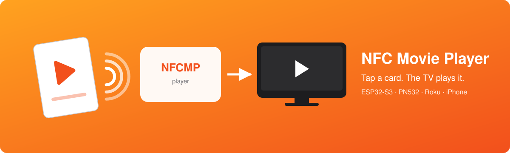</p>

# NFCMP: NFC Movie Player

Put a movie or show on an NFC card. Tap the card on the player and your Roku TV turns on and starts it: Netflix, Jellyfin, Disney+ and more. Titles are picked in the **NFCMP** iPhone app and stored on the card itself.

- **Tap to play.** Each card holds its own title, so it works on any player and survives a wiped board.
- **Search everything.** The app searches your own Jellyfin library and every streaming service (through TMDB), and shows where each title streams in the US.
- **No typing on the board.** The first time it's powered on, the player opens its own Wi-Fi network with a setup page that asks only for your Wi-Fi. Everything else is set up in the app, and the player finds the TV and the Jellyfin server by itself.

> [!IMPORTANT]
> **Roku only for now.** Cards play on Roku TVs today. Google TV support is written (pairing, power and app links all run on the player) but hasn't been tested on a real Google TV yet, so treat it as a work in progress. I'm working on it. Samsung is planned after that.

> [!NOTE]
> Netflix and Jellyfin are proven on a real TV. Disney+, Hulu, Prime Video, Apple TV and Max cards are written in the same format, but whether each app opens the right title hasn't been tested yet.

## Contents

1. [How it works](#how-it-works)
2. [Bill of materials](#bill-of-materials)
3. [Build the hardware](#build-the-hardware) (steps 1–3)
4. [Install the software on the board](#install-the-software-on-the-board) (steps 4–8)
5. [First-time setup](#first-time-setup) (steps 9–10)
6. [Install the iPhone app](#install-the-iphone-app) (steps 11–12)
7. [Make your first card](#make-your-first-card) (steps 13–15)
8. [Updating later](#updating-later)
9. [What's on a card](#whats-on-a-card)
10. [Troubleshooting](#troubleshooting)
11. [Project layout](#project-layout)
12. [Credits](#credits)

---

## How it works

<p align="center">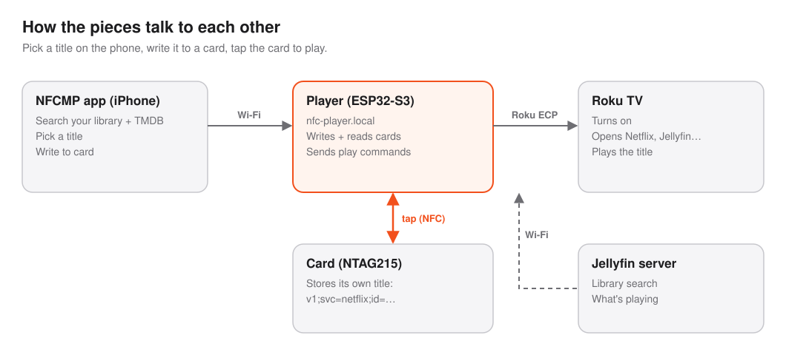</p>

1. In the **NFCMP** app, search for a title and tap **Write to card**.
2. Hold a card to the top of your iPhone. The app writes the title onto the card. (Or tap **Write on player**, and the next card tapped on the player gets it.)
3. From then on, tapping that card turns on the TV and opens the title using the TV's deep links. Cards don't name a TV, so the same cards will also play on a Google TV once that support is finished.

The player is an ESP32-S3 running MicroPython, with a PN532 NFC reader connected over I2C.

---

## Bill of materials

<p align="center">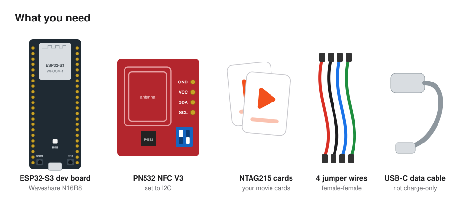</p>

| Part | Qty | Notes | Link |
| --- | :-: | --- | --- |
| Waveshare ESP32-S3 Wi-Fi dev board (ESP32-S3-WROOM-1, **N16R8**: 16 MB flash, 8 MB PSRAM) | 1 | The brains. Laid out like Espressif's ESP32-S3-DevKitC-1. | [Amazon](https://www.amazon.com/dp/B0DLWGVXCS) |
| AITRIP PN532 NFC RFID module V3 | 1 | The card reader. Set to I2C mode in step 1. | [Amazon](https://www.amazon.com/dp/B0GTNRDXYB) |
| NTAG215 NFC cards or stickers | as many as you like | Your movie cards. About 500 bytes each, plenty for one title. | any |
| Female-to-female jumper wires | 4 | Red, black and two other colors make the wiring easy to check. | any |
| USB-C cable | 1 | **Must carry data**, not just charging. | any |

**You also need**

| Thing | Why |
| --- | --- |
| A Roku TV | Plays the titles. Google TV is a work in progress (see the note at the top). Netflix, Jellyfin and the other apps must already be installed and signed in on it. |
| 2.4 GHz Wi-Fi | The ESP32 can't join 5 GHz networks. If your router shows a separate "5G" network, use the other one. |
| A Mac with Python 3 | To flash and copy code to the board. |
| An iPhone and Xcode | To install the NFCMP app. Writing cards with the iPhone needs a paid Apple Developer account; a free Apple ID works with limits (see step 11). |
| A Jellyfin server (optional) | For library search and the blank-card shortcut. |
| A TMDB API key (free) | For searching streaming services in the app. Get one at [themoviedb.org](https://www.themoviedb.org/settings/api). |

> [!TIP]
> The white S50 card that comes with the PN532 kit is MIFARE Classic, not NTAG215. It's fine for checking the reader works, but it can't hold a title. Use NTAG215 cards for movies.

---

## Build the hardware

### Step 1: Set the PN532 to I2C

<p align="center">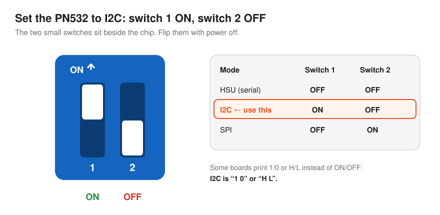</p>

**You'll need:** the PN532 module, a toothpick or small screwdriver.

1. Find the two tiny switches beside the PN532 chip.
2. Push **switch 1 to ON** and **switch 2 to OFF**.
3. Check against the table printed on the board: I2C is `1 0`.

> [!WARNING]
> Only flip the switches with the board unpowered. The PN532 reads them when it starts.

> [!TIP]
> If the PN532's header pins came loose in the bag, solder them on before wiring.

### Step 2: Wire the PN532 to the ESP32

<p align="center">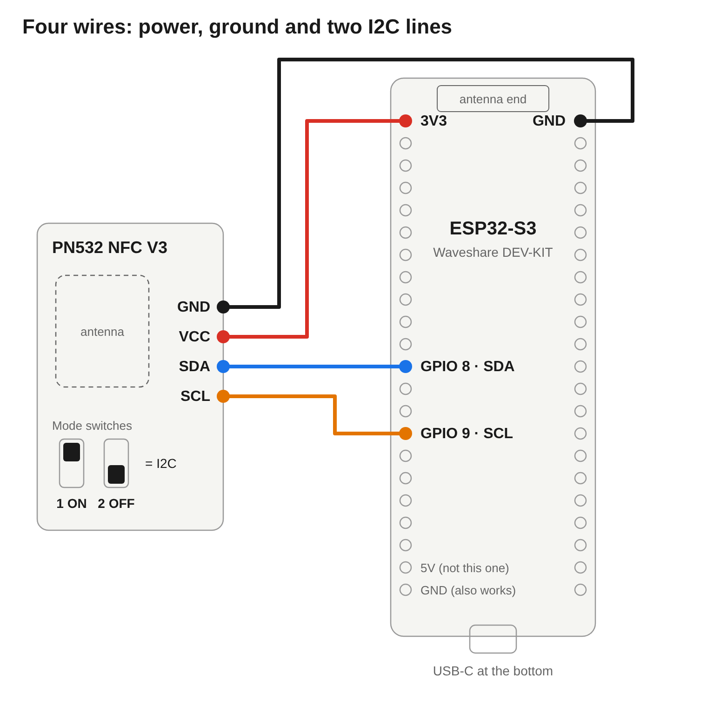</p>

**You'll need:** both boards, 4 jumper wires.

Hold the ESP32 with the **USB-C port at the bottom**. Then connect:

| Wire | PN532 pin | ESP32-S3 pin | Where on the ESP32 |
| --- | --- | --- | --- |
| Red | VCC | **3V3** | Left header, top pin |
| Black | GND | **GND** | Right header, top pin (the bottom-left GND works too) |
| Blue | SDA | **GPIO 8** | Left header, 12th pin from the top |
| Orange | SCL | **GPIO 9** | Left header, 15th pin from the top |

> [!CAUTION]
> Use **3V3**, not **5V**. At 5V the PN532 can pull the data lines above what the ESP32's pins can take. The 5V pin is second from the bottom on the left; skip it.

> [!TIP]
> The PN532's header is usually labelled `GND VCC SDA SCL`. Go by the labels printed on your board, not by position. GPIO 8 and 9 are this board's standard I2C pins.

### Step 3: Plug the board into your Mac

1. Connect the ESP32's USB-C port to your Mac.
2. A red **PWR** light comes on.
3. Check the Mac can see it:

   ```sh
   ls /dev/cu.usbmodem*
   ```

   You should see something like `/dev/cu.usbmodem101`. That's the board's port.

> [!TIP]
> No port listed? The cable is probably charge-only. Try another one.

---

## Install the software on the board

<p align="center">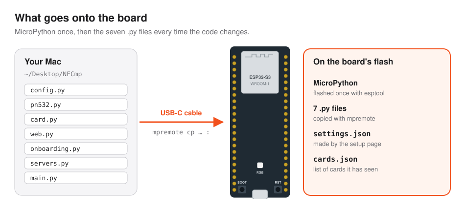</p>

### Step 4: Install the tools on your Mac

```sh
python3 -m pip install mpremote esptool
```

- **esptool** flashes MicroPython onto the board (once).
- **mpremote** copies the code and shows the board's log.

### Step 5: Get the code

```sh
git clone https://github.com/orangeflow95/NFCmp.git
cd NFCmp
```

Everything below runs from this `NFCmp` folder.

### Step 6: Flash MicroPython (first time only)

> [!IMPORTANT]
> Pick the **SPIRAM_OCT** variant. The N16R8 board has octal PSRAM, and the standard build won't use its 8 MB.

1. Download the **Octal-SPIRAM** firmware from [micropython.org/download/ESP32_GENERIC_S3](https://micropython.org/download/ESP32_GENERIC_S3/). The file is named like `ESP32_GENERIC_S3-SPIRAM_OCT-20260824-v1.29.0.bin`.
2. Erase the board:

   ```sh
   esptool --chip esp32s3 erase-flash
   ```

3. Write MicroPython, using the file you downloaded:

   ```sh
   esptool --chip esp32s3 --baud 460800 write-flash 0 ESP32_GENERIC_S3-SPIRAM_OCT-20260824-v1.29.0.bin
   ```

4. Press **RST** on the board to restart it.

<p align="center">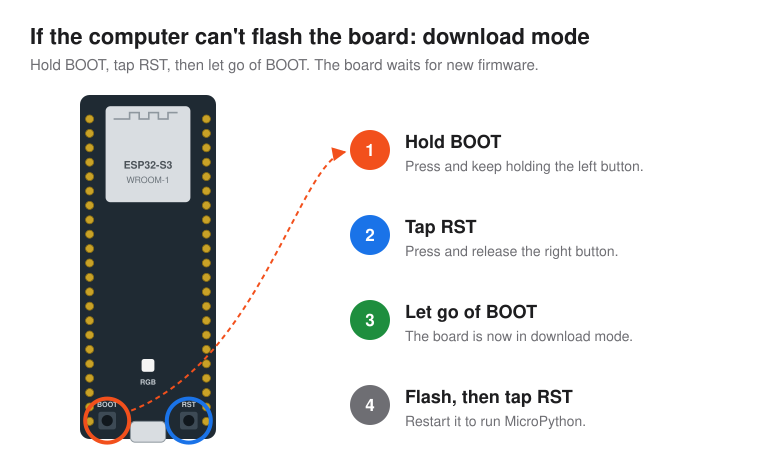</p>

> [!TIP]
> - **"Failed to connect":** put the board in download mode by hand. Hold **BOOT**, tap **RST**, let go of **BOOT**, then run the command again.
> - **Fails halfway:** drop `--baud 460800` to flash at the slower default speed.
> - **More than one board plugged in:** add `--port /dev/cu.usbmodem101` (your port from step 3).
> - **Older esptool:** the commands are `esptool.py` and `erase_flash` / `write_flash`.

### Step 7: Copy the code to the board

```sh
mpremote cp config.py pn532.py card.py web.py onboarding.py servers.py api.py tv.py roku.py googletv.py tlskey.py main.py :
```

The `:` at the end means "the board". `main.py` runs automatically every time the board starts.

| File | What it does |
| --- | --- |
| `main.py` | Reads taps, plays cards, writes titles sent from the app, runs the player's web page |
| `card.py` | The title record stored on each card |
| `pn532.py` | Talks to the NFC reader; reads and writes card memory |
| `onboarding.py` | The setup network and its Wi-Fi page |
| `api.py` | The setup API the app uses: choose the TV, pair, media server |
| `tv.py` | Picks the TV code for the TV chosen in setup and opens each card's title in the right app |
| `roku.py` | Roku: finds it, turns it on, deep links |
| `googletv.py` | Google TV: finds it, pairs with it, turns it on, opens app links |
| `tlskey.py` | Makes the certificate the player uses to pair with a Google TV |
| `servers.py` | Finds Jellyfin (or Plex), signs in, searches the library |
| `web.py` | Small web-server helpers |
| `config.py` | Fixed settings: pins, timeouts, streaming app IDs |

> [!NOTE]
> Your Wi-Fi password and server sign-in are **not** in these files. You enter the Wi-Fi on the setup page in step 9 and the rest in the app in step 13. The board keeps them in its own `settings.json`.

### Step 8: Restart and watch the log

```sh
mpremote reset && mpremote repl
```

On a brand-new board you'll see:

```text
Setup mode: join the Wi-Fi network 'NFC Movie Player' on your phone (or open http://192.168.4.1/).
```

Press **Ctrl-]** to leave the log. The board keeps running.

> [!TIP]
> `PN532 not found. Check the wiring and that the board's switches are set to I2C.` means the reader didn't answer. Recheck step 1 and step 2, unplug USB, and plug it back in.

---

## First-time setup

### Step 9: Join the player's network

1. On your iPhone, open **Settings → Wi-Fi** and join **NFC Movie Player**. It's an open network with no password.
2. A setup sheet pops up. If it doesn't, open Safari and go to `http://192.168.4.1`.
3. Pick your home Wi-Fi (nearby networks are suggested as you tap the box), enter the password and tap **Connect**.

<p align="center">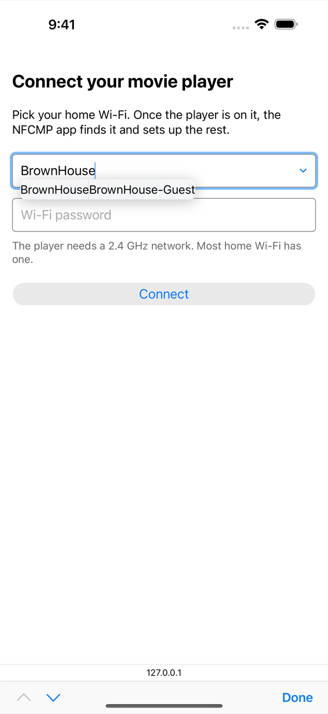</p>

That's the only thing the setup page asks. The TV, Google TV pairing and the media server are set up in the app (step 13).

> [!NOTE]
> The player needs a **2.4 GHz** network. If the password is wrong, the **NFC Movie Player** network comes back after about 20 seconds with your entries filled in.

### Step 10: Watch it connect

The player restarts and joins your Wi-Fi. Switch your phone back to your home network. In the log (`mpremote repl`):

```text
Wi-Fi connected: 192.168.1.50
No TV chosen yet. Open the NFCMP app to finish setting up.
NFC reader ready: PN532 v1.6
0 card(s) linked. Waiting for a tap...
```

- **Moving it to another Wi-Fi later:** in the app, **Player settings → Move to another Wi-Fi**, or open `http://nfc-player.local/setup`.

---

## Install the iPhone app

### Step 11: Put NFCMP on your iPhone

1. Open `ios/NFCPlayer.xcodeproj` in Xcode.
2. Click **NFCPlayer** → **Signing & Capabilities** → **Team**, and choose your paid Apple Developer team. Add your Apple ID under **Add Account** if it isn't listed. Then change the bundle identifiers in `ios/project.yml` (`com.orangeflow.nfcplayer` and `com.orangeflow.nfcplayer.share`) to your own and run `xcodegen`, since those IDs belong to another team.
3. Plug in your iPhone and pick it at the top of the Xcode window.
4. Press **▶ Run**.
5. On the iPhone, the first time:
   1. Turn on **Settings → Privacy & Security → Developer Mode**. The phone restarts.
   2. If iOS asks, trust your developer profile in **Settings → General → VPN & Device Management**.

> [!IMPORTANT]
> The app reads and writes cards with the iPhone's NFC, which needs the paid Apple Developer Program ($99/year). A free Apple ID can't sign it. To build with one, remove the `entitlements` block from `ios/project.yml` and run `xcodegen`: **Write on player** still works, but the phone can't touch cards and the app stops opening after 7 days.

> [!NOTE]
> The Xcode project is generated from `ios/project.yml` with [XcodeGen](https://github.com/yonaskolb/XcodeGen). If you add files or change settings, run `cd ios && xcodegen`.

### Step 12: Add your TMDB key

Open **NFCMP**. Paste your TMDB API key into the box at the top. It's saved only on your phone.

The badge in the top-left corner shows whether the app can reach the player:

| Badge | Meaning |
| --- | --- |
| ● **Online** (green) | The player answered at `nfc-player.local` |
| ● **Offline** (orange) | Not found. Check the phone and player are on the same Wi-Fi, or set the address under **⋯ → Player address**. |

### Step 13: Choose your TV

The first time the app finds a player with no TV, it opens **Player settings** by itself. You can also get there from **⋯ → Player settings** or by tapping the **Online** badge.

<table>
<tr>
<td width="25%">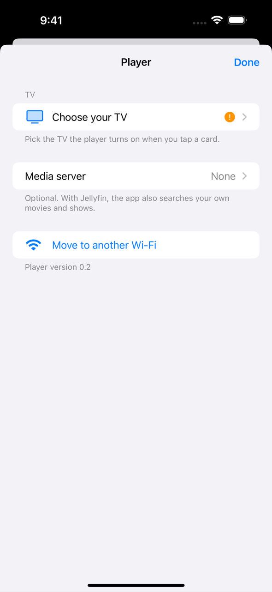</td>
<td width="25%">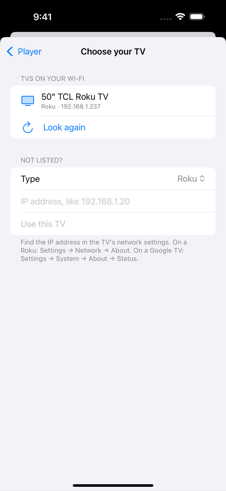</td>
<td width="25%">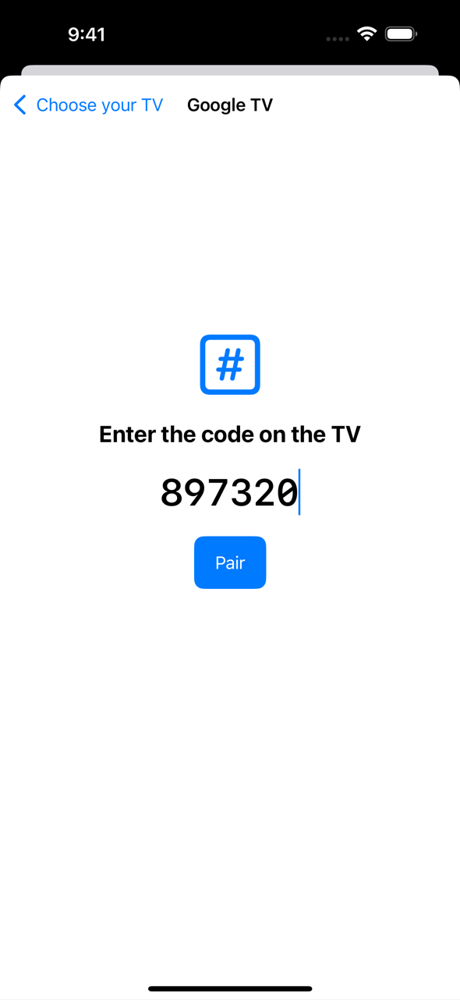</td>
<td width="25%">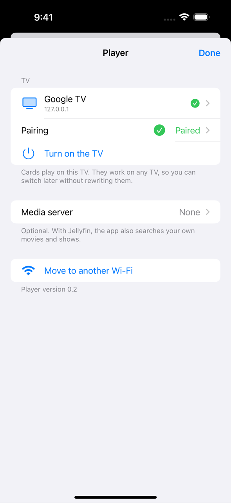</td>
</tr>
<tr>
<td><b>1.</b> Tap <b>Choose your TV</b>.</td>
<td><b>2.</b> The player lists the Rokus and Google TVs on your Wi-Fi by name. Tap yours. Not listed? Enter its IP address under <b>Not listed?</b></td>
<td><b>3.</b> <b>Google TV only (work in progress, untested):</b> turn the TV on, tap <b>Show code on TV</b> and type the code the TV shows.</td>
<td><b>4.</b> A green check means cards will play. <b>Turn on the TV</b> tests it.</td>
</tr>
</table>

- **Google TV is a work in progress.** The app lists Google TVs and has pairing built in, but none of it has been tested on a real Google TV yet, only against a simulated one. Use a Roku for now.
- **Google TV, "Getting ready":** the first time, the player spends a minute or two making its own security certificate before it can pair. The app waits and carries on by itself.
- **Media server (optional):** **Player settings → Media server**. Choose Jellyfin or Plex and sign in with the account the TV's app uses. The address is found automatically.
- **Changing TVs later:** cards don't name a TV, so the same cards play on the new one.

---

## Make your first card

### Step 14: Find the title

<table>
<tr>
<td width="33%">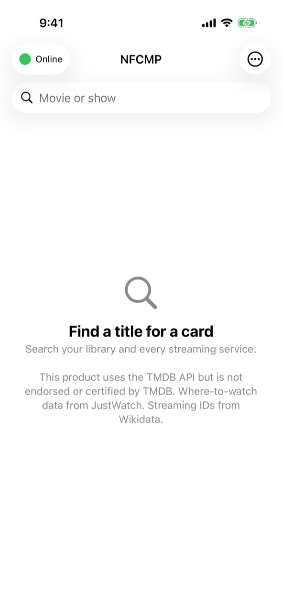</td>
<td width="33%">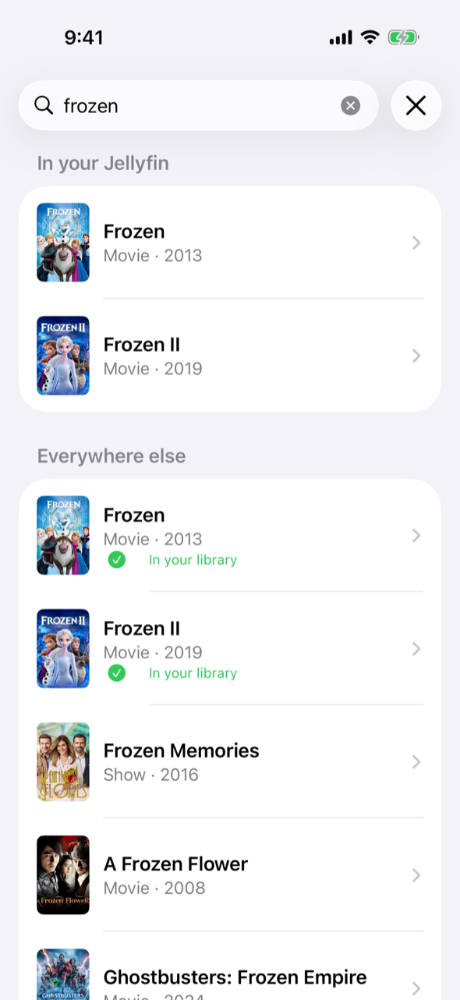</td>
<td width="33%">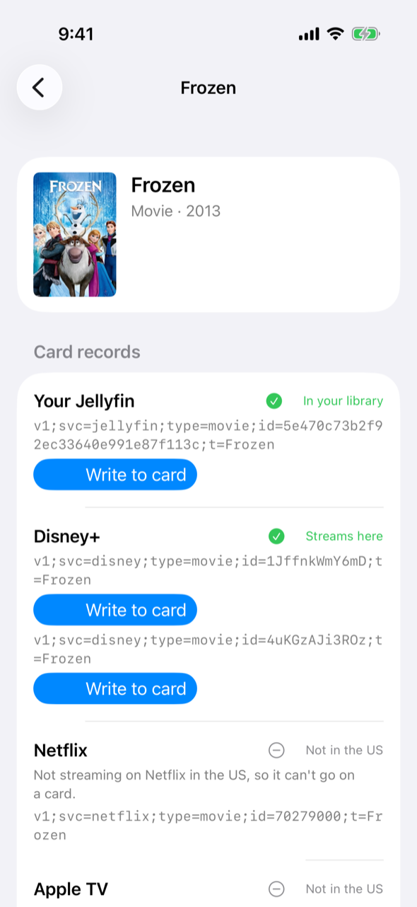</td>
</tr>
<tr>
<td><b>1.</b> Type a movie or show and press Search.</td>
<td><b>2.</b> Titles <b>in your Jellyfin</b> come first. A green check marks streaming results you also own.</td>
<td><b>3.</b> Pick a title to see every way to play it. Services that don't stream it in the US have no button.</td>
</tr>
</table>

### Step 15: Write it to a card

<table>
<tr>
<td width="50%">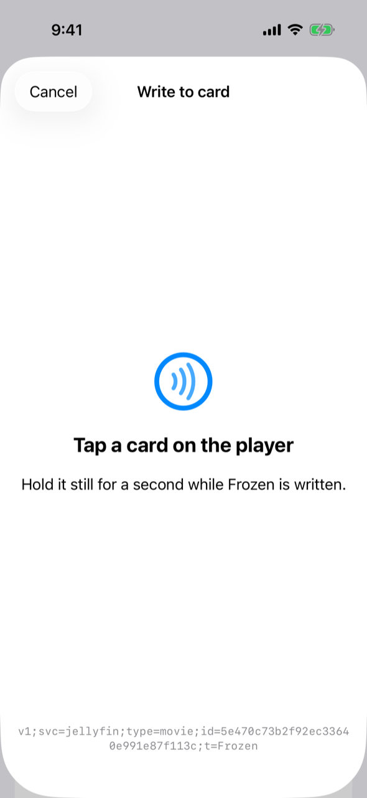</td>
<td width="50%">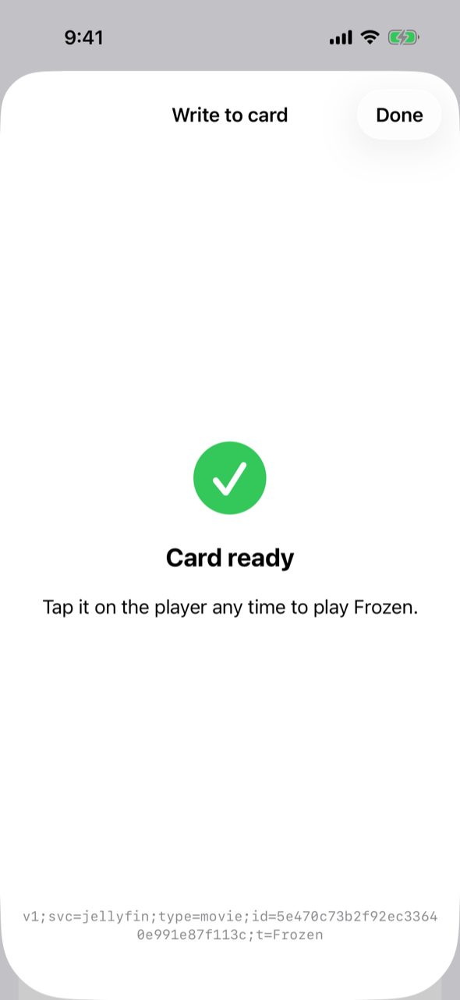</td>
</tr>
<tr>
<td><b>1.</b> Tap <b>Write to card</b> and hold an NTAG215 card to the top of your iPhone until it says <b>Card ready</b>. To use the player instead, tap <b>Write on player</b>, then tap the card on the player and <b>hold it still for a second</b> (shown here).</td>
<td><b>2.</b> <b>Card ready.</b> The title is now stored on the card.</td>
</tr>
</table>

- **The write fails** (the card moved): the app says so, and you just try again.
- **No card within 2 minutes (Write on player):** the player stops waiting. Tap **Try again** in the app.
- **Check a card:** tap the card icon at the top of the app's home screen and hold a card to your iPhone to see what's on it.
- **Safe to pull away:** a card pulled away mid-write reads as blank, never half old and half new.

### Step 16: Play it

Tap the card on the player. The TV turns on, waits 3 seconds, and opens the title.

> [!TIP]
> **Jellyfin shortcut, no phone needed:** tap a **blank** card on the player, then start something in Jellyfin on the TV within 2 minutes. The card learns it. Tap any card to cancel.

> [!NOTE]
> **Netflix asks "Who's watching?":** pick your profile, then tap the card again. Netflix forgets the title when it shows the profile screen.

---

## Updating later

When the code changes, there's no need to flash MicroPython or redo setup:

```sh
cd NFCmp
git pull
mpremote cp config.py pn532.py card.py web.py onboarding.py servers.py api.py tv.py roku.py googletv.py tlskey.py main.py : && mpremote reset
```

Your settings (`settings.json`) and cards are kept. Cards carry their own titles, so even deleting the board's card list doesn't unlink them.

| Handy command | What it does |
| --- | --- |
| `mpremote repl` | Watch the log (Ctrl-] to leave) |
| `mpremote cat :cards.json` | List the cards the player has seen |
| `mpremote cp settings.json :` | Copy saved settings to a new board and skip setup |
| `mpremote rm :settings.json` | Forget all settings and redo setup |

---

## What's on a card

<p align="center">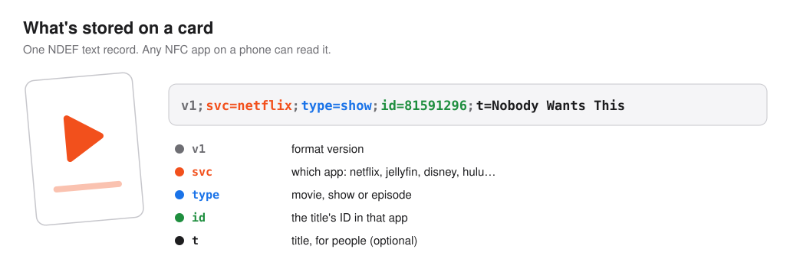</p>

Each card holds one standard NDEF text record, so any NFC app on a phone can read it. Some examples:

```text
v1;svc=netflix;type=show;id=81591296;t=Nobody Wants This
v1;svc=jellyfin;type=movie;id=183be3c815b9c0e6d1b9882e99439d72;t=Frozen
v1;svc=disney;type=movie;id=1JffnkWmY6mD;t=Frozen
```

| `svc` | Roku app | On Roku | On Google TV (in progress) |
| --- | --- | --- | --- |
| `netflix` | Netflix (12) | ✅ Plays | ⚠️ Untested (`netflix.com/title/<id>` link) |
| `jellyfin` | Jellyfin (592369) | ✅ Plays (IDs only work with your server) | ⚠️ Untested (started through the Jellyfin server; needs it set up in settings) |
| `disney`, `hulu`, `prime`, `appletv`, `max` | Disney+, Hulu, Prime Video, Apple TV, HBO Max | ⚠️ App IDs confirmed, deep links untested | ⚠️ Untested |
| `youtube` | YouTube (837) | ⚠️ Untested | ⚠️ Untested |
| `plex` | Plex (13535) | ⚠️ Untested | ❌ Not supported yet |

---

## Troubleshooting

| Problem | Fix |
| --- | --- |
| `PN532 not found` in the log | Switches not on I2C (step 1), or SDA/SCL swapped or loose (step 2). Unplug and replug after fixing. |
| The setup sheet doesn't appear | Open `http://192.168.4.1` in Safari while joined to **NFC Movie Player**. |
| **NFC Movie Player** keeps coming back | The player can't join your Wi-Fi: wrong password, or a 5 GHz network. |
| App says **Offline** | Phone and player must be on the same Wi-Fi. Try **⋯ → Player address** with the IP from the log. |
| "Couldn't reach the player to search your library" | Same as Offline. TMDB results still work. |
| Write to card keeps failing | Hold the card flat and still against the top of the iPhone, or on the reader for a full second. Use NTAG215, not the S50 card. |
| A card does nothing | It may be blank and no media server is set up; write a title to it from the app. |
| Cards do nothing on a Google TV | Google TV support is still in progress and untested. If you're trying it: pair in **Player settings → Pairing**, and pair again after a factory reset of the TV. |
| Netflix opens on its home screen | It showed "Who's watching?" first. Pick a profile and tap the card again. |
| A mature Netflix title won't play | Netflix uses the last profile; a Kids profile blocks it. |
| The app won't open | Its signing ran out. Reinstall from Xcode (step 11). |
| No **Write to card** button | That service doesn't stream it in the US, or Wikidata has no ID for it. |

---

## Project layout

```text
NFCmp/
├── main.py            Tap handling, playback, Jellyfin learning, web page
├── card.py            Card record format (NDEF text record)
├── pn532.py           PN532 driver: card UID, NTAG page read/write
├── onboarding.py      Setup network, captive Wi-Fi page
├── api.py             Setup API for the app (TV, pairing, media server)
├── tv.py              Plays a card on the TV picked in setup
├── roku.py            Roku: discovery, power, deep links (ECP)
├── googletv.py        Google TV: discovery, pairing, power, app links
├── tlskey.py          RSA key and certificate for Google TV pairing
├── servers.py         Jellyfin/Plex discovery, sign-in, library search
├── web.py             Tiny HTTP helpers
├── config.py          Pins, timeouts, streaming app IDs
├── wiring/            Wiring diagram (PNG and SVG)
├── docs/images/       Pictures for this README
└── ios/               NFCMP iPhone app (SwiftUI, XcodeGen)
    ├── project.yml
    ├── NFCPlayer/
    └── NFCPlayerUITests/   Takes this README's app screenshots
```

---

## Credits

- This product uses the TMDB API but is not endorsed or certified by TMDB. Movie and show data from [TMDB](https://www.themoviedb.org).
- Where-to-watch data from [JustWatch](https://www.justwatch.com), through TMDB.
- Streaming IDs from [Wikidata](https://www.wikidata.org).
- ESP32-S3 pin positions from [CircuitState's pinout](https://www.circuitstate.com/pinouts/waveshare-esp32-s3-dev-kit-nxr8-wi-fi-development-board-pinout-diagram-arduino-reference/).
- Runs on [MicroPython](https://micropython.org).

## License

[MIT](LICENSE)
